## WebStorm 简介

### 概念

WebStorm 是 JetBrains 公司推出的一款 JavaScript 开发工具，在开发者群体中常被称为「最好用的前端开发工具」。它属于 JetBrains 系列 IDE 中的前端分支，在保持较轻量的同时，内置了代码智能提示、检查与调试能力，可直接承接 JavaScript、TypeScript、HTML、CSS 及各类前端框架的开发。

### 主要特点

- 智能编码：基于上下文的代码补全、语法高亮、格式化、重构与错误检查，对 JavaScript、TypeScript、HTML、CSS 及其预处理器、前端框架均有专门支持。
- 工具链内置：调试器、单元测试、Git 等版本控制、终端、npm 脚本都集成在 IDE 内部，不必再逐个安装插件。
- 框架友好：对 React、Vue、Angular、Node.js 等主流技术栈提供模板、导航与提示支持。
- 平台一致：与 IntelliJ IDEA、PyCharm 同属 JetBrains 系，界面布局与快捷键体系基本一致，掌握其中一个即可快速迁移。
- 商业授权：属于收费软件，需购买正式授权；学生与教师可申请免费授权，另提供 30 天免费试用。

### 官方资料

- [WebStorm 官网](https://www.jetbrains.com/webstorm/)
- [WebStorm 历史版本下载](https://www.jetbrains.com/webstorm/download/previous.html)
- [JetBrains 学生与教师授权申请方式](https://sales.jetbrains.com/hc/zh-cn/articles/207154369-%E5%AD%A6%E7%94%9F%E6%8E%88%E6%9D%83%E7%94%B3%E8%AF%B7%E6%96%B9%E5%BC%8F)

## WebStorm 安装

### 介绍

WebStorm 是 JetBrains 公司的一款 JavaScript 开发工具，号称最好用的前端开发工具。

### 下载

官网地址：[http://www.jetbrains.com/webstorm/](http://www.jetbrains.com/webstorm/)

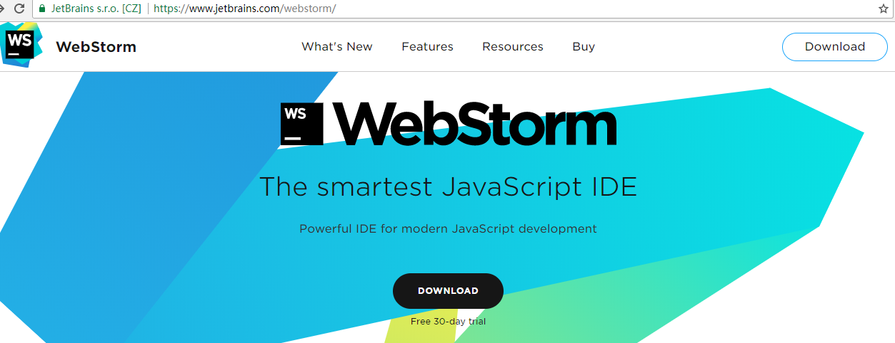

在上图点击「Download」下载最新版本。

下载旧版本，进入下载界面：[https://www.jetbrains.com/webstorm/download/previous.html](https://www.jetbrains.com/webstorm/download/previous.html)

本教程使用 2018.2.3 版本。

### 安装

运行 WebStorm 的安装文件：`WebStorm-2018.2.3.exe`

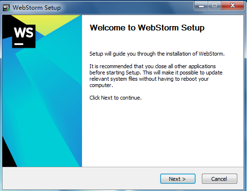

执行下一步进行安装，可以在下图选择将 32 位、64 位启动程序放在桌面。

本教程使用 32 位的启动程序。

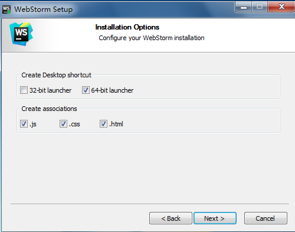

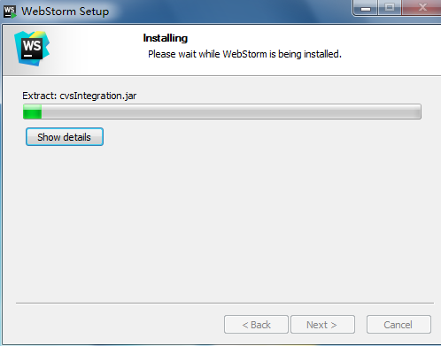

安装成功，下图为安装目录：

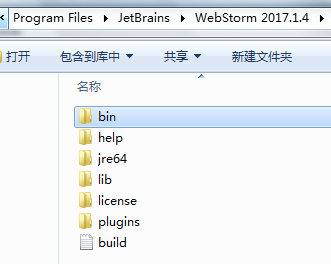

启动，出现下边的提示：

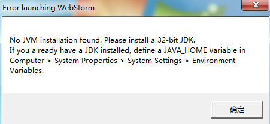

WebStorm 需要 JDK 支持，由于本教程启动的是 32 位的 WebStorm，所以需要安装 32 位的 JDK。

> [!tip] 启动程序的位数要与 JDK 位数保持一致，32 位 WebStorm 必须搭配 32 位 JDK，否则启动会失败。

JDK 安装略。

再次启动，提示：

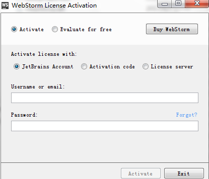

该软件需要授权方可使用，可选择以下三种方式：

1. 学生和老师申请免费授权：[学生授权申请方式](https://sales.jetbrains.com/hc/zh-cn/articles/207154369-%E5%AD%A6%E7%94%9F%E6%8E%88%E6%9D%83%E7%94%B3%E8%AF%B7%E6%96%B9%E5%BC%8F)
2. 购买正式授权：[购买地址](https://www.jetbrains.com/idea/buy/#edition=commercial)
3. 先免费使用 30 天：选择 `Evaluate for free`

选择任意一种方式，下一步 WebStorm 重启进入下图：

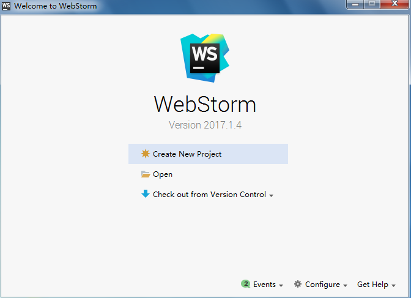

### 基本设置

#### 主题

黑色主题：

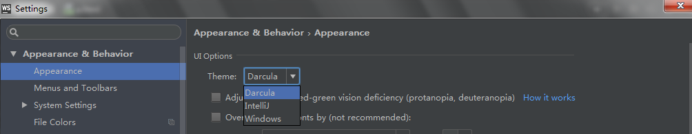

#### 字体

设置菜单字体：

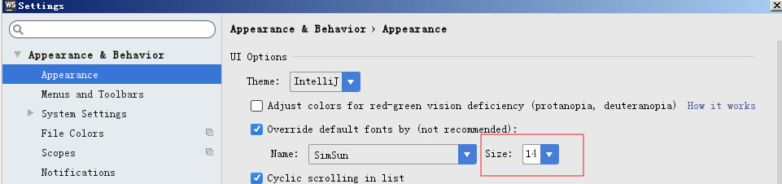

设置内容字体大小：

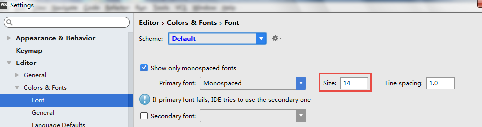

#### 代码模板

html5 代码模板：

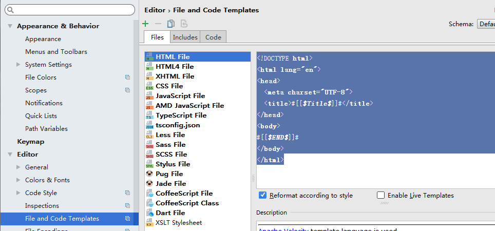

```html
<!DOCTYPE html>
<html lang="en">
<head>
  <meta charset="UTF-8">
  <title></title>
</head>
<body>

</body>
</html>
```

#### 快捷键

对于熟悉 Eclipse 快捷键的用户可以设置 Eclipse 快捷键：

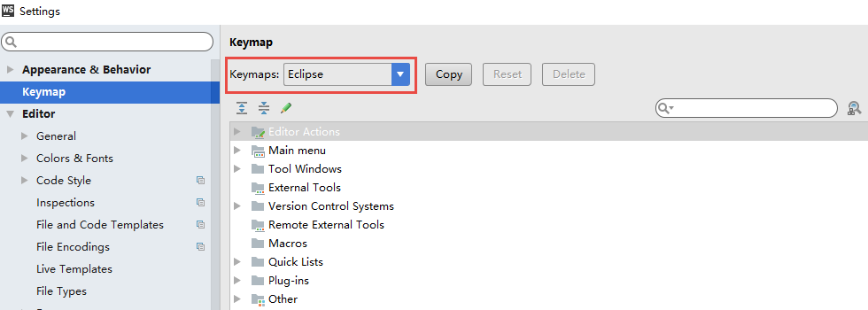

自定义快捷键，下边以删除行为例子：

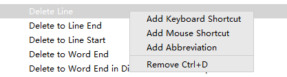

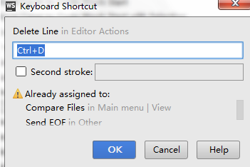

#### Node.js 环境配置

如果本机没有安装 Node.js 则先安装。

Node.js 安装略。

在 WebStorm 中设置 `node.exe`：

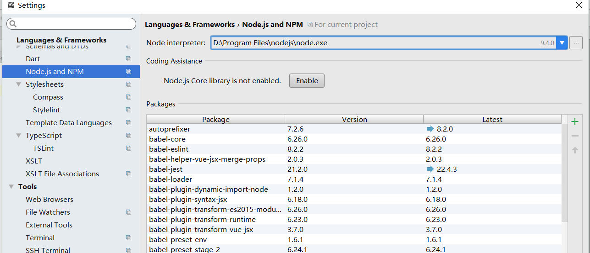

#### 添加 Node.js 源代码

为了在程序中对 Node.js 的一些类库有提示，在 WebStorm 中添加 Node.js 库：

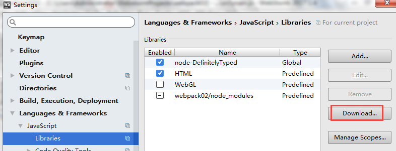

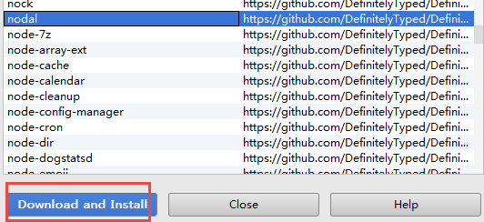
